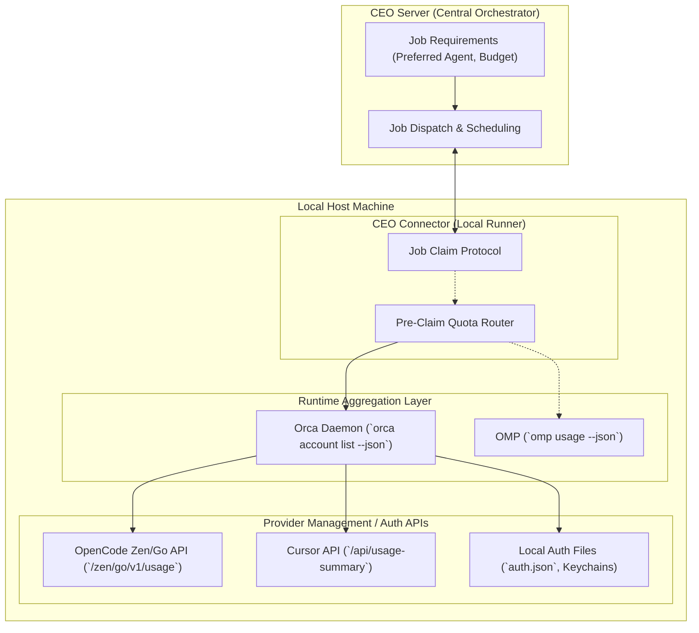

# Agent Runtime Quota and Availability Probe Report

**Date:** 2026-10-04  
**Target:** CEO Agent Runtime (`/home/sentimentalk/codes/ceo-agent-runtime`)  
**Scope:** Read-only capability probe of local Agent / Orca stack for runtime availability, quota, rate-limit, and reset-time observability.  
**Execution Constraints:** Zero modification to production code, zero consumption of paid inference tokens, zero exposure of secrets/tokens/credentials.

---

## 1. Environment & Versions Tested

All probes were executed directly against locally installed binaries in the active Linux environment (`Linux x86_64 6.8.0-45-generic`).

| Component | Executable Path | Version Observed | Probe Status |
| :--- | :--- | :--- | :--- |
| **Orca** | `/home/sentimentalk/.config/orca/linux-orca-cli-shim/orca` | `1.4.219` | Present & running (daemon connected) |
| **OpenCode** | `/home/sentimentalk/.opencode/bin/opencode` | `1.18.34` | Present |
| **Cursor Agent** | `/home/sentimentalk/.local/bin/cursor-agent` | `2026.10.01-e373342` | Present |
| **Oh My Pi (OMP)** | `/home/sentimentalk/.local/bin/omp` | `omp/17.2.11` | Present |
| **Antigravity CLI (agy)** | `/home/sentimentalk/.local/bin/agy` | `1.2.16` | Present |
| **Antigravity Desktop** | `/usr/local/bin/antigravity` | `2.11.0` | Present |
| **Pi** | `/home/sentimentalk/.local/bin/pi` | `1.0.2` | Present |

---

## 2. Capability Matrix

| Agent / Runtime | Machine-readable Model Discovery? | Machine-readable Quota / Availability? | Fields Observed | Safe Probe Command | Confidence |
| :--- | :--- | :--- | :--- | :--- | :--- |
| **Orca** | Partial (delegated per agent) | **YES** (multi-provider aggregator) | `status`, `error`, `updatedAt`, `session` (`usedPercent`, `windowMinutes`, `resetsAt`), `weekly` (`usedPercent`, `windowMinutes`, `resetsAt`), `monthly` (`usedPercent`, `windowMinutes`, `resetsAt`), `usageMetadata` (`source`, `credentialSource`, `authProvenance`, `failureKind`) | `orca account list --json` | **High** (verified against live runtime) |
| **OpenCode** | **YES** (static catalog) | **NO** via CLI (YES via Orca/upstream API) | CLI: Local historical session stats only (`totalCost`, tokens, tool calls).<br>Upstream API: `rolling` (5h / 300m), `weekly` (7d / 10080m), `monthly` (30d / 43200m) with `usedPercent` / `usedMicroCents`, `limitMicroCents`, `resetsAt`. | `opencode stats`, `opencode providers list`, `opencode models --verbose` | **High** |
| **OMP** | **YES** | **YES** (observed accounting & provider limits) | `provider`, `limits[]` (`id`, `label`, `window` {`durationMs`}, `amount` {`used`, `limit`, `remaining`, `usedFraction`, `remainingFraction`, `unit`}, `status`), `capacity`, `metadata`, `notes` | `omp usage --json --redact` | **High** |
| **Cursor Agent** | Text list only (`cursor-agent models`) | **NO** via CLI | `status`, `isAuthenticated`, `subscriptionTier: "Pro"`. No remaining % or rolling window in CLI. (Upstream web API has `usage-summary` used by Orca/UI). | `cursor-agent status --format json`, `cursor-agent about --format json` | **High** |
| **Antigravity** | Text list only (`agy models`) | **NO** via CLI | CLI exposes no quota. Model inference gRPC response contains `GetRemainingFcaQuota`. Orca flags: `"Antigravity usage is not available. Orca can only show shared Google Code Assist quota while a Gemini CLI sign-in is connected."` | `agy models` | **High** |
| **Pi** | Text list only (`pi --list-models`) | **NO** (Auth check only) | `status`, `provider`, `reason` (auth configuration readiness only). No quota or rate-limit fields. | `pi auth check --json --no-refresh` | **High** |

---

## 3. Direct Command & Output Evidence

*(All credentials, auth tokens, personal identifiers, and email addresses have been completely redacted.)*

### 3.1 Orca: `orca account list --json`

Orca's CLI provides direct access to its runtime RPC `accounts.list`. When `--json` is supplied, Orca emits a comprehensive `rateLimits` payload across configured agent providers.

```bash
$ orca account list --json
```

```json
{
  "id": "562a356b-22ea-4ef9-a5af-9f63270bd832",
  "ok": true,
  "result": {
    "claude": { "accounts": [], "activeAccountId": null },
    "codex": { "accounts": [], "activeAccountId": null, "systemDefault": { "hasAuth": false } },
    "rateLimits": {
      "opencodeGo": {
        "provider": "opencode-go",
        "session": {
          "usedPercent": 0,
          "windowMinutes": 300,
          "resetsAt": 1791159353813,
          "resetDescription": null
        },
        "weekly": {
          "usedPercent": 36,
          "windowMinutes": 10080,
          "resetsAt": 1791158400000,
          "resetDescription": null
        },
        "monthly": {
          "usedPercent": 18,
          "windowMinutes": 43200,
          "resetsAt": 1793733880000,
          "resetDescription": null
        },
        "updatedAt": 1791141353902,
        "error": null,
        "status": "ok",
        "usageMetadata": {
          "source": "web",
          "credentialSource": "opencode-auth-file",
          "lastSuccessfulSource": "web"
        }
      },
      "cursor": {
        "provider": "cursor",
        "session": null,
        "weekly": null,
        "updatedAt": 1791141353706,
        "error": "Cursor sign-in expired — run `cursor-agent login` again",
        "status": "error",
        "usageMetadata": {
          "source": "cli",
          "credentialSource": "cli",
          "authProvenance": "[REDACTED_HASH]",
          "failureKind": "stale-token"
        }
      },
      "antigravity": {
        "provider": "antigravity",
        "session": null,
        "weekly": null,
        "updatedAt": 1791141353510,
        "error": "Antigravity usage is not available. Orca can only show shared Google Code Assist quota while a Gemini CLI sign-in is connected.",
        "status": "unavailable"
      },
      "claude": {
        "provider": "claude",
        "session": null,
        "weekly": null,
        "status": "unavailable",
        "error": "No subscription plan — API key billing"
      },
      "codex": {
        "provider": "codex",
        "session": null,
        "weekly": null,
        "status": "unavailable",
        "error": "Codex not signed in"
      },
      "gemini": {
        "provider": "gemini",
        "status": "unavailable",
        "error": "Gemini CLI OAuth is disabled in settings"
      },
      "kimi": { "provider": "kimi", "status": "unavailable", "error": "Not signed in to Kimi Code" },
      "minimax": { "provider": "minimax", "status": "unavailable", "error": "MiniMax session cookie not configured" },
      "grok": { "provider": "grok", "status": "unavailable", "error": "Not signed in to Grok — run grok login" },
      "zcode": { "provider": "zcode", "status": "unavailable", "error": "ZCode Coding Plan credentials are not configured" }
    }
  }
}
```

### 3.2 OpenCode: Local CLI Probes

1. **`opencode stats`**: Shows local SQLite execution history only.
   ```text
   ┌────────────────────────────────────────────────────────┐
   │                       OVERVIEW                         │
   ├────────────────────────────────────────────────────────┤
   │Sessions                                             34 │
   │Messages                                          1,469 │
   │Days                                                  4 │
   └────────────────────────────────────────────────────────┘
   ┌────────────────────────────────────────────────────────┐
   │                    COST & TOKENS                       │
   ├────────────────────────────────────────────────────────┤
   │Total Cost                                        $5.08 │
   │Avg Cost/Day                                      $1.27 │
   │Avg Tokens/Session                                 3.8M │
   │Input                                              8.7M │
   │Output                                           284.6K │
   │Cache Read                                       119.2M │
   └────────────────────────────────────────────────────────┘
   ```
2. **`opencode providers list`**:
   ```text
   ┌  Credentials ~/.local/share/opencode/auth.json
   │
   ●  OpenCode Zen api
   │
   ●  OpenCode Go api
   │
   └  2 credentials
   ```
3. **`opencode models --verbose`**: Emits model catalog JSON (cost per token, context window, capabilities), but zero dynamic user quota or remaining balance.

### 3.3 Oh My Pi (OMP): `omp usage --json --redact`

OMP possesses a first-class machine-readable `usage` command with JSON support and redaction.

```bash
$ omp usage --json --redact
```

```json
{
  "accountsWithoutUsage": [],
  "capacity": [
    { "window": "5h", "accountsUsed": 0, "accountsTotal": 1, "multiplierRemaining": 1 },
    { "window": "7d", "accountsUsed": 0, "accountsTotal": 1, "multiplierRemaining": 1 },
    { "window": "30d", "accountsUsed": 0, "accountsTotal": 1, "multiplierRemaining": 1 }
  ],
  "reports": [
    {
      "provider": "opencode-go",
      "metadata": {
        "planType": "OpenCode Go",
        "source": "omp-observed-request-costs"
      },
      "notes": [
        "OMP-observed spend only; OpenCode usage outside OMP is not included."
      ],
      "limits": [
        {
          "id": "rolling-5h",
          "label": "5 Hour limit",
          "window": { "id": "rolling-5h", "label": "5 Hour", "durationMs": 18000000 },
          "amount": { "used": 0, "limit": 12, "remaining": 12, "usedFraction": 0, "remainingFraction": 1, "unit": "usd" },
          "status": "ok"
        },
        {
          "id": "weekly",
          "label": "Weekly limit",
          "window": { "id": "weekly", "label": "Weekly", "durationMs": 604800000 },
          "amount": { "used": 0, "limit": 30, "remaining": 30, "usedFraction": 0, "remainingFraction": 1, "unit": "usd" },
          "status": "ok"
        },
        {
          "id": "monthly",
          "label": "Monthly limit",
          "window": { "id": "monthly", "label": "Monthly", "durationMs": 2592000000 },
          "amount": { "used": 0, "limit": 60, "remaining": 60, "usedFraction": 0, "remainingFraction": 1, "unit": "usd" },
          "status": "ok"
        }
      ]
    }
  ]
}
```

### 3.4 Cursor: `cursor-agent status` & `about`

```bash
$ cursor-agent status --format json
```
```json
{
  "hasAccessToken": true,
  "hasRefreshToken": true,
  "isAuthenticated": true,
  "status": "authenticated",
  "userInfo": {
    "createdAt": "[REDACTED]",
    "email": "[REDACTED]",
    "firstName": "[REDACTED]",
    "lastName": "[REDACTED]",
    "userId": "[REDACTED]"
  }
}
```

```bash
$ cursor-agent about --format json
```
```json
{
  "cliVersion": "2026.10.01-e373342",
  "subscriptionTier": "Pro",
  "latestStatus": "up-to-date",
  "osPlatform": "linux",
  "osArch": "x64"
}
```
*Note: Cursor Agent CLI provides no quota, usage percentage, or reset time command.*

### 3.5 Antigravity: `agy models`

`agy models` queries the remote backend and outputs model IDs and display names in text format:
```text
gemini-3.8-flash-high     Gemini 3.8 Flash (High)
gemini-3.8-flash-medium   Gemini 3.8 Flash (Medium)
claude-opus-5-5-high      Claude Opus 5.5 (High)
...
```
Binary inspection of `agy` demonstrates that remaining quota (`GetRemainingFcaQuota`) is received solely in `GenerateChatResponse` gRPC messages during model generation turns.

### 3.6 Pi: `pi auth check`

```bash
$ pi auth check --provider opencode --json --no-refresh
```
```json
{
  "status": "not_ready",
  "provider": "opencode",
  "reason": "credentials_not_configured"
}
```
Pi exposes machine-readable authentication checks, but has no runtime usage/quota monitoring commands.

---

## 4. Orca Current Capability Conclusion

1. **Orca Already Contains a Rate-Limit / Quota Subsystem:**
   - Orca does **not** merely perform model discovery; it already runs a background usage/quota monitoring subsystem.
   - It exposes this through RPC method `accounts.list` via CLI `orca account list --json`.
   - The returned data structure includes normalized `rateLimits` covering `claude`, `codex`, `gemini`, `opencodeGo`, `kimi`, `antigravity`, `minimax`, `grok`, `cursor`, and `zcode`.

2. **Mechanism in Orca Codebase:**
   - Code inspection of Orca's unpacked bundle (`resources/app.asar`) shows:
     - **OpenCode Go:** Orca reads the API key from `~/.local/share/opencode/auth.json` (or OpenCode credential database / environment variable `OPENCODE_API_KEY`). It then calls `GET https://opencode.ai/zen/go/v1/usage`.
     - **Cursor:** Orca locates credentials from Cursor desktop or `cursor-agent` storage, then attempts to query `https://cursor.com/api/usage-summary` or `https://cursor.com/api/usage`.
     - **Historical Local Usage:** Orca runs an internal worker (`usage-scan-worker-entry.js`) that directly reads SQLite databases (OpenCode, Claude, Codex) and JSONL logs to aggregate session costs and tokens.

3. **Status vs. Command Semantics:**
   - The quota capability currently rides inside `orca account list --json`. While the human text output only displays account emails, the `--json` output returns the full `rateLimits` object.
   - Orca does not consume model tokens to fetch these metrics; it uses management API endpoints or cached state.

---

## 5. Per-Agent Deep Dive & Conclusions

### 5.1 OpenCode: Rolling / Weekly / Monthly Quota Visibility

- **CLI Surface:** OpenCode CLI (`opencode`) has **no** command for querying live quota, rate limits, or reset times. `opencode stats` only tallies local SQLite session history.
- **Upstream Service Seam:** OpenCode's UI and Orca both resolve quota via `https://opencode.ai/zen/go/v1/usage`.
- **Observed Dimensions:**
  - **Rolling (Session) Bucket:** Window is 300 minutes (5 hours). Orca extracts `usedPercent: 0%`, resets in ~5 hours.
  - **Weekly Bucket:** Window is 10,080 minutes (7 days). Orca extracts `usedPercent: 36%`, resets at `1791158400000`.
  - **Monthly Bucket:** Window is 43,200 minutes (30 days). Orca extracts `usedPercent: 18%`, resets at `1793733880000`.
- **Model Sharing vs. Independent Buckets:**
  - *Evidence:* The OpenCode Go usage API response (`access.meters` or `usage`) returns account-level meters (`fiveHour`, `week`, `month`).
  - *Finding:* In OpenCode Go, all models routed through OpenCode Go draw against the same account-level 5-hour, weekly, and monthly budget meters, rather than having isolated quotas per individual model.

### 5.2 Oh My Pi (OMP)

- **CLI Surface:** First-class machine-readable command `omp usage --json [--redact]`.
- **Observed Dimensions:**
  - For OpenCode Go: Tracks spend locally under `source: "omp-observed-request-costs"` against fixed limits ($12/5h, $30/week, $60/month).
  - Explicitly states: *"OMP-observed spend only; OpenCode usage outside OMP is not included."*
  - For providers with live management APIs (e.g. Anthropic/OpenAI OAuth), OMP queries provider limit endpoints.
- **Safety:** Querying `omp usage` does not consume model tokens.

### 5.3 Cursor (`cursor-agent`)

- **CLI Surface:** `cursor-agent status --format json` reveals authentication status (`isAuthenticated`, user IDs). `cursor-agent about --format json` reveals `subscriptionTier: "Pro"`.
- **Quota Visibility:** No CLI command outputs quota percentage, remaining fast requests, or rolling reset times.
- **UI Seam:** Cursor Web/Desktop UI queries private endpoint `https://cursor.com/api/usage-summary` with session cookies.

### 5.4 Antigravity (`agy` / `antigravity`)

- **CLI Surface:** `agy models` lists models. No quota or usage command exists.
- **Quota Visibility:** Quota (`GetRemainingFcaQuota`) is returned exclusively as a field in the gRPC `GenerateChatResponse` message during active chat turns.
- **Orca Assessment:** Orca explicitly marks Antigravity quota as `unavailable` unless linked through a shared Gemini CLI OAuth login.
- **Inference Risk:** Querying Antigravity quota from the CLI requires initiating an actual model completion turn, which directly violates the zero-cost requirement.

### 5.5 Pi (`pi`)

- **CLI Surface:** `pi auth check --json --no-refresh` provides machine-readable auth configuration status.
- **Quota Visibility:** No quota or rate-limit tracking exists in the CLI.

---

## 6. Recommended Ownership Boundary



### Boundary Rationale:

1. **Orca (Local Runtime Aggregator):**
   - **Role:** Natural owner of host-level multi-agent telemetry and credential aggregation.
   - **Evidence:** Orca already implements credential discovery across `auth.json`, SQLite databases, and keychains, and aggregates quota from `https://opencode.ai/zen/go/v1/usage` and Cursor APIs.
   - **Recommendation:** Rather than reinventing provider API scrapers in Connector, encourage upstreaming or utilizing Orca's existing `rateLimits` subsystem (ideally formalizing it under an alias like `orca quota --json` or `orca availability --json`).

2. **CEO Connector (Local Router before Claiming):**
   - **Role:** Gatekeeper for Job claims.
   - **Action:** Before claiming a Job that targets OpenCode, Cursor, or OMP, Connector polls `orca account list --json` (or OMP CLI if independent).
   - If `opencodeGo.session.usedPercent >= 95%` or `cursor.status === "error"`, Connector flags the agent as `exhausted` or `rate_limited`, delaying Job claim or falling back to an available agent alternative.

3. **CEO Server (Central Dispatcher):**
   - **Role:** Pure scheduler.
   - **Boundary:** Receives coarse availability status (e.g. `available`, `degraded`, `exhausted`, `reset_at`) via Connector heartbeat. CEO Server should **not** manage local credentials, cookie jars, or vendor-specific usage endpoints.

---

## 7. Minimal Proposed Normalized Availability Schema

The following minimal contract is recommended for the Connector's pre-claim availability router:

```typescript
export type AvailabilityStatus =
  | 'available'      // Quota healthy, ready to launch
  | 'degraded'       // High usage (e.g. >80%), near saturation
  | 'exhausted'      // 100% of rolling or billing window consumed
  | 'rate_limited'   // HTTP 429 received or transient limiter active
  | 'auth_required'  // Missing API key, expired token, or login needed
  | 'unavailable'    // Agent not installed or service unreachable
  | 'unknown';       // Agent does not expose a non-destructive probe

export interface QuotaWindow {
  id: string;               // e.g. "rolling-5h", "weekly", "monthly"
  label: string;            // Human-readable name
  windowMinutes: number;    // Window duration (e.g. 300, 10080, 43200)
  usedPercent: number;      // 0.0 to 100.0
  resetsAt: number | null;  // Epoch timestamp in milliseconds
}

export interface AgentRuntimeAvailability {
  provider: string;         // e.g. "opencode-go", "cursor", "omp", "antigravity"
  agent: string;            // e.g. "opencode", "cursor-agent", "omp", "agy"
  status: AvailabilityStatus;
  canAcceptJobs: boolean;   // Quick boolean predicate for router
  windows: QuotaWindow[];   // Observed quota windows
  earliestResetAt: number | null; // Earliest resetsAt among exhausted/degraded windows
  rawMetadata?: {
    probeSource: 'orca_rpc' | 'omp_cli' | 'agent_cli' | 'inferred';
    credentialSource?: string;
    authProvenance?: string;
    errorMessage?: string;
    [key: string]: unknown;
  };
  probedAt: number;         // Timestamp ms when probed
}
```

---

## 8. Unknowns & Unattempted Probes

1. **Live Model Completion Probes (Zero Paid Token Rule):**
   - We did **not** execute test prompts (`agy -p "hi"`, `cursor-agent "ping"`, `opencode run "ping"`) to observe live token consumption headers or test gRPC `GetRemainingFcaQuota` values.
2. **Direct Manual Private Endpoint Requests:**
   - We did **not** manually forge HTTP requests using personal session cookies or tokens extracted from local disk to third-party web portals (e.g. `cursor.com/api/usage`), ensuring zero credential leakage or brittle reverse-engineering.
3. **OpenCode Per-Model Sub-Meters:**
   - While OpenCode Go exposes account-wide 5h/weekly/monthly meters, whether specific frontier models (e.g. Opus vs Flash) consume microcents from the shared meter at differing multiplier rates is managed server-side and is not separately broken down in the account usage endpoint.
